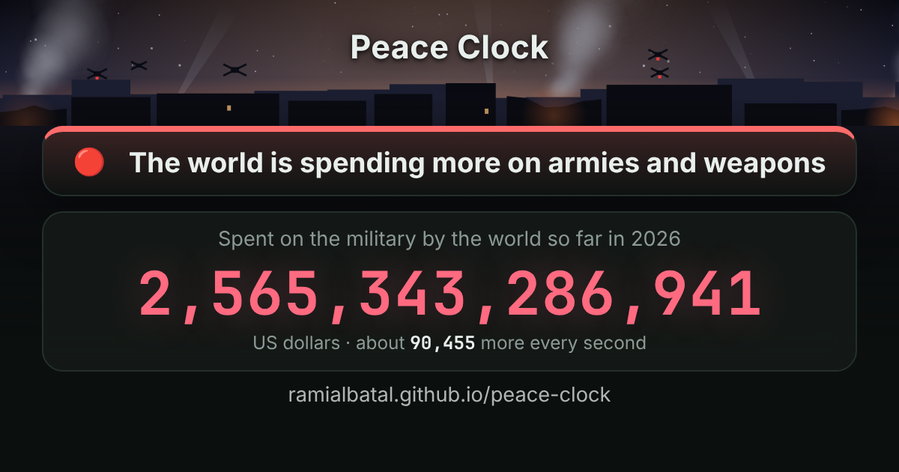

# Peace Clock



**Live site: https://ramialbatal.github.io/peace-clock/**

A live clock of what the world spends on the military, second by second, next to the lives lost to war and what the
same money could pay for. It answers one question first, in plain words: is the world spending more or less on armies
and weapons?

**Languages:** English, French, Spanish and Arabic. The globe at the top switches language; `?lang=fr`, `?lang=es` or
`?lang=ar` opens one directly. Translations live in `js/i18n/`; corrections from native speakers are very welcome.

**What can I do?** A button under the answer opens three evidence-based actions, each with its source (`js/actions.js`).

**Privacy:** visits are counted anonymously with [GoatCounter](https://www.goatcounter.com/) (no cookies, no
personal data). The link-preview picture (`img/og-image.png`) is refreshed every Monday by a GitHub Action
(`npm run og-image`), so shared links show that week's answer and number.

**On your own website:** "Add to your site" at the top gives a one-line code for a small live widget (the answer and
the counter), in the language you have open. The widget is the same page with `?embed=1`.

Serve the folder with any static server (`npm run serve`, then open http://localhost:8000) or any static host. There's
no build step. Opening `index.html` straight from disk won't work: browsers block ES modules on `file://` pages.

## Data

All fetched live in the browser from [Our World in Data](https://ourworldindata.org/military-personnel-spending):

| What | Source | Notes |
|---|---|---|
| Military spending | [SIPRI Military Expenditure Database](https://www.sipri.org/databases/milex) | Constant 2024 US dollars, every country, latest year 2025 |
| Share of the economy | SIPRI | Military spending as a share of GDP |
| Lives lost to war | [Uppsala Conflict Data Program](https://ucdp.uu.se/) | Best estimate of soldiers and civilians killed in all armed conflicts, by the country where the fighting happened |
| UN humanitarian appeal | [OCHA, Global Humanitarian Overview 2026](https://www.unocha.org/publications/report/world/press-release-life-life-un-launches-33-billion-aid-appeal-urgent-call-global-solidarity) | $33 billion for 2026; typed into `js/config.js`, updated every December |

## Method

- **Spending this year** = the latest official year, projected with each country's latest year-on-year change (capped
  at 25%), spread evenly over the year (UTC).
- **Lives lost this year** = the latest complete year's total, at the same pace. UCDP also publishes a partial count for
  the current year; the clock leaves it out because its cut-off date varies. Deaths from hunger and disease caused by
  war are not counted, so the real toll is higher.
- **"What could it pay for?"** = the UN's yearly humanitarian appeal divided by one day of world military spending.
- **"Are countries rearming?"** = how many of the 18 biggest spenders spent more (after inflation) in the latest year.

## Run it and check it

```sh
npm run serve        # then open http://localhost:8000
npm install          # dev tools only: TypeScript checker, Playwright, clock-core (types and tests)
npm run check        # house style + types + unit tests
npx playwright install chromium   # once, for the smoke test
npm run smoke        # real browser, real data, desktop and phone, every language and the widget
```

Settings live in `js/config.js`, calculations in `js/model.js` (unit tested), page code in `js/app.js`, the picture behind the header in `js/scene.js`. Shared helpers
and styles come from [clock-core](https://github.com/ramialbatal/clock-core), pinned to an exact commit in `index.html` and `package.json`.
How the clocks are built, lessons learned and rules for new code: [developer notes](https://github.com/ramialbatal/clock-core/tree/main/docs).

## Contributing

Issues and pull requests are welcome: see [CONTRIBUTING.md](CONTRIBUTING.md).

## Licence

Code: [MIT](LICENSE). Data: SIPRI (free for non-commercial use, with attribution), UCDP (CC BY 4.0), via Our World in
Data (CC BY 4.0).
